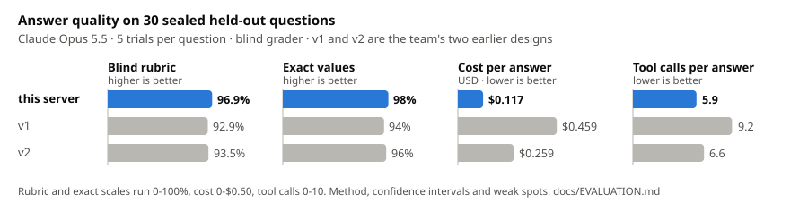
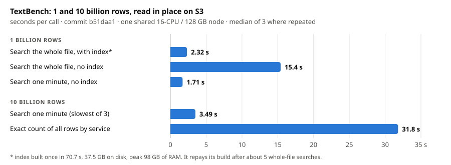
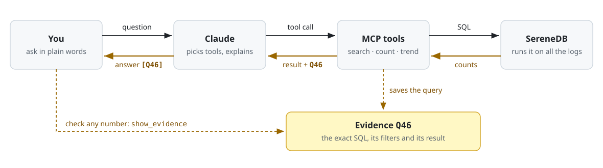

<div align="center">

# serenedb-extractor

<h3>Ask your logs in plain words. Every number in the answer links to the SQL that produced it.</h3>

[](https://modelcontextprotocol.io)
[](https://serenedb.com)
[](#)

</div>

An MCP server that lets Claude investigate millions of log lines for three people: an **engineer** chasing an
error, a **team lead** looking for recurring problems, and a **manager** deciding what comes first. SereneDB does
the searching and counting. Claude explains the results.

**Demo video:** _link to come_ · **Worked investigation:** [below](#worked-investigation-one-corpus-three-roles) ·
**Requirements checklist:** [docs/reference.md](docs/reference.md#requirements-checklist)

## Optional features

Beyond the required workflow:

| feature | what it does | measured |
|---|---|---|
| **Polished MCP server** | 18 tools that say when to use them, what they take and what they return. Results are capped and say when they were cut. Role prompts `/engineer`, `/team-lead`, `/manager` | **96.9%** on 30 sealed held-out questions, blind-graded, at **$0.117** per answer, benchmarked when it had 12 tools ([evaluation](docs/EVALUATION.md)) |
| **Huge datasets** | Reads TextBench in place from the public S3 bucket: one file of **1 billion rows** and ten files of **10 billion rows**. Nothing is downloaded | 1B rows: whole file searched in **2.32 s** with an index, **15.4 s** without. 10B rows: one minute searched in **3.49 s**, all rows counted in **31.8 s** ([timings](docs/HUGE_DATASETS.md)) |
| **Agent-managed indexes** | `create_index` (with a `dry_run` size and time estimate) and `drop_index`. The agent builds an index for an investigation and removes it after | the 1B-row index takes **70.7 s** to build and repays itself after about 5 whole-file searches ([trade-off](docs/HUGE_DATASETS.md#the-trade-off-index-build-time-against-query-time)) |
| **Logs with metrics and traces** | Metric and trace tables next to the log tables. `telemetry_overview` shows a system's logs, metrics and traces around one moment, per service. `metric_changes`, `metric_series`, `trace_changes` (self time and network time per call) and `get_trace` go deeper || RCAEval root-cause benchmark: right service ranked first in **96.3%** of 348 held-out trials ([below](#rcaeval-root-cause-from-logs-metrics-and-traces)) |
| **Phrase and fuzzy search** | `search_logs` matches words in order, or with `fuzzy` each word within a typo or two, through the search index | |
| **Template mining** | Groups log lines into message templates at question time (SQL masking, then Drain), kept as stable IDs `T1, T2, …` | best BGL grouping score (FGA 0.745) of every approach compared, published parsers included ([table](docs/EVALUATION.md#templating-better-grouping-than-drain-on-the-full-loghub-20-data)) |



The chart compares three MCP server designs the team built over the same data
([how they differ](docs/EVALUATION.md#the-three-designs-compared)). Questions written blind, answers graded blind.

With this server, by model (both at commit `6cad141`):

| model | questions | blind rubric | exact values | USD per answer |
|---|---|---|---|---|
| Opus 5.5 | 30 sealed held-out, 5 trials each | **96.9%** | **98%** | 0.117 |
| Sonnet 5.5 | 30 screening, 3 trials each | 93.3% | 96% | **0.036** |

The two models answered different question sets, so this is not a head-to-head.

### RCAEval: root cause from logs, metrics and traces

[RCAEval](https://github.com/phamquiluan/RCAEval) cases are microservice failures (Online Boutique, Sock Shop,
Train Ticket) with the faulty service known. The agent names the root-cause service. AC@1 is the share of trials
where its first pick is right, AC@3 where the right one is in its top three.

| question set | tools | trials | AC@1 | AC@3 |
|---|---|---|---|---|
| **held-out, 116 cases** | logs, metrics and traces | 348 | **96.3%** | 99.1% |
| held-out, 116 cases | BARO (RCAEval's non-LLM method, reference only) | 116 | 21% | 90% |
| test, 48 cases | logs only | 48 | 56% | 58% |
| test, 48 cases | logs, metrics and traces | 48 | 100% | 100% |

Sonnet 5.5, 3 trials per held-out case, extractor `785b7ba`. Resource faults (CPU, memory, disk, network) show up
in metrics, not logs, which is where logs alone fail. The test set is at its ceiling, so the held-out set is the
result. BARO is not a like-for-like contestant. Details: [docs/EVALUATION.md](docs/EVALUATION.md#rcaeval-logs-metrics-and-traces).



## How it works

<p align="center">
  
</p>

Claude sees query results, never raw logs. Each query is saved as `Q<n>`, and `show_evidence` shows its SQL.

To group messages into kinds, SereneDB masks values (`<NUM>`, `<PATH>`, …) in SQL and counts identical masked
messages. [Drain3](https://github.com/logpai/Drain3) then merges groups that differ only in plain words. Each
template keeps a stable ID (`T1`, `T2`, …) that later tools accept.


## Quick start

You need Docker, [uv](https://docs.astral.sh/uv/) and Claude Code or Codex.

```sh
git clone https://github.com/ugnmura/serenedb-extractor && cd serenedb-extractor
uv sync

# 1. start SereneDB (drop --platform on an x86-64 host)
mkdir -p ~/logs
docker run -d --name serenedb --platform linux/amd64 -e SERENEDB_HOST_AUTH_METHOD=trust \
  -p 127.0.0.1:7890:7890 -v ~/logs:/logs:ro \
  serenedb/serenedb@sha256:6d41ac6577e797289158786a2015ba8fbd6875feadb5c491518e166c011058c9

# 2. load BGL + OpenStack (downloads ~60 MB, takes about a minute)
export SERENEDB_READER_URL=postgresql://postgres@localhost:7890/postgres
export LOGS_HOST_DIR=~/logs LOGS_CONTAINER_DIR=/logs
uv run python scripts/load_base_corpus.py

# 3a. connect Claude Code
claude mcp add serenedb-extractor \
  -e SERENEDB_READER_URL=$SERENEDB_READER_URL -e SERENEDB_ALLOW_SQL=1 \
  -e LOGS_HOST_DIR=$HOME/logs -e LOGS_CONTAINER_DIR=/logs \
  -- uv run --directory "$PWD" serenedb-extractor

# 3b. or connect Codex
codex mcp add serenedb-extractor \
  --env SERENEDB_READER_URL=$SERENEDB_READER_URL --env SERENEDB_ALLOW_SQL=1 \
  --env LOGS_HOST_DIR=$HOME/logs --env LOGS_CONTAINER_DIR=/logs \
  -- uv run --directory "$PWD" serenedb-extractor
```

Then run `claude` in this folder and ask (the role commands live in `.claude/commands/`):

```text
/engineer What failed on BGL on 11 June 2005, and what happened just before?
/team-lead Which problems keep recurring, and what should we look at first?
/manager What should we prioritise from these logs?
```

- **Codex:** there are no role commands. Name the role in the question, for example "As the engineer: what failed
  on BGL on 11 June 2005?". `/mcp` lists the connected server.
- **Apple Silicon:** use `serenedb/serenedb:26.09.2` (native arm64) and leave out `--platform`. The pinned image
  is slow and may crash under emulation.
- **Local SereneDB and our own loader:** the organisers supplied no loader, schema, ownership table or instance.
- Passwords, reader and writer roles, other options: [docs/reference.md](docs/reference.md).

## Worked investigation: one corpus, three roles

One question per role, all about BGL (4,747,963 entries). Only the team lead's whole-corpus count also covers
OpenStack, since the brief asks for one aggregation over the whole base corpus. 25 tool calls, median 0.49 s, no
index. `[step n]` points to the [transcript](docs/worked-investigation-transcript.md) with every call, result and
query. Full write-up: [docs/worked-investigation.md](docs/worked-investigation.md). BGL times are US Pacific.

### Engineer: "What failed on BGL, and what happened just before it?"

- **Found by:** `count_logs` on FATAL entries by node, full-text `search_logs`, `get_context`.
- **What failed:** one compute node, **R30-M0-N9-C:J16-U01**, produced **152,229 of BGL's 855,501 FATAL entries**
  (17.8%). The next node has 1,567 [step 2]. Almost all of them are `data TLB error interrupt`
  (152,182) [step 3], in one run on 11 June 2005 from 17:17:44 PDT through the 23:00 hour [steps 3, 4].
- **Just before:** in the same second, the node logged `machine check interrupt (bit=0x10): L2 DCU read error`
  [step 5]. Nothing else on the machine was logged in the 10 minutes before [step 6]. That error appears only 3 times in the whole log,
  twice on this node [step 7].
- **Possible cause (hypothesis):** a faulty L2 data cache on the node's processor.
- **Next check:** run the processor and L2 diagnostics on that node. If they fail, take it out of the scheduler
  and replace the card. If they pass, look at the job that ran there at 17:17.

### Team lead: "Which problems keep recurring, and what should the team look at first?"

- **Found by:** `count_logs` over the whole corpus by team and level, `trend` by week and day, `survey`.
- **Whole-corpus counts by team** (fictional stand-in ownership table) [step 9]: Node OS 626,756 FATAL and HPC
  Applications 228,536 FATAL on BGL, Virtualization 3,071 WARNING on OpenStack.
- **Recurring:** "Link has been severed" (CioStream socket) on **22 of 31 days** in December, 14,616 entries, +4%
  against November [step 21]. Kernel fault storms are rarer but huge: 62% of all BGL FATAL entries fall in 9-15
  June [step 11]. On OpenStack, an image-cache warning appears in each of the 15 hours checked, 97 to 136 times an hour [step 16].
- **Investigate first:** **HPC Applications**, the "Link has been severed" failures: the most persistent fatal
  problem, and not falling. Then Node OS, to confirm whether the 14 June burst (344,064 FATAL entries in three hours)
  was a planned restart [step 13].

### Manager: "What should we prioritise, and what happens next?"

- **Found by:** `rank_problems` for December 2005 against November, scored on measured severity, change,
  persistence, spread and share [step 23]. The score orders the list. It is not a cost figure.

| # | risk (measured) | owner | next action |
|---|---|---|---|
| 1 | Broken links between compute and I/O nodes: FATAL, 22 of 31 days, 1,024 nodes, 31% of the ranked entries | HPC Applications | trace which I/O-node links drop |
| 2 | Failing job launches ("permission denied"), up 91% (7,296 → 13,952) | HPC Applications | review program-image permissions |
| 3 | Lustre mounts failing, up 716% (230 → 1,877) on 924 nodes | Node OS | check the mounts and their servers for those 4 days |
| 4 | One faulty node in June: 17.8% of all FATAL entries | Node OS | hardware diagnostics, out of service until it passes |

### What the data does and does not establish

Every number above is an exact count over every entry in scope. The counts are log entries, not incidents. Causes
are hypotheses. Downtime, cost and customer impact are not in the logs. A check against ground truth: a full-text
count of "data TLB error interrupt" over all of BGL gives **152,734**, exactly the number of lines BGL's own
labels mark as `KERNDTLB` [steps 24, 25].

### A second engineer finding: two 503s at 06:25 (OpenStack)

OpenStack's only 2 CRITICAL entries are failed token checks after Keystone returned `503`, at 06:25 on 16 and on
17 May. After the second, API polling fell from about 2,830 to 12 requests an hour and no VM finished starting
again. The anomaly labels mark neither. **Hypothesis:** the daily cron job at 06:25 reloads Apache, which hosts
Keystone. **Next check:** Keystone's Apache log and `/etc/crontab`.
[Transcript](docs/keystone-503-transcript.md).

## Tools

Claude picks these from their descriptions. Every result says how it was measured and when it was cut.

| tool | what it does |
|---|---|
| `describe_logs` | lists the log tables, their fields and time ranges. The starting point |
| `search_logs` | full-text search in a time window, returns matching entries |
| `get_context` | the events just before and after one entry |
| `count_logs` | exact counts by team, component, level or time, over one log table or all of them |
| `survey` | the most common kinds of message |
| `trend` | what is rising, falling or new compared with the period before |
| `rank_problems` | what to look at first, ranked by a stated, measured score |
| `show_evidence` | the exact SQL and result behind any cited number |

18 tools in total, including setup, indexes and team ownership. Inputs and outputs: [docs/reference.md](docs/reference.md#tools).

## Evidence

- **Counted in the database.** Counts cover every entry in scope. An estimate states its margin.
- **No evidence, no claim.** Every statement about the logs is cited. `[Q46]` next to a number, time or message
  means "run `show_evidence(['Q46'])` to see the query".
- **Facts and guesses kept apart.** Causes are labelled hypotheses. Each answer says what the logs do not show.

## Limitations

- Counts are log entries, not incidents.
- The team-ownership table is a fictional stand-in. `edit_team_ownership` imports a real one.
- Log tables are snapshots and are not refreshed.
- The answer-quality finals ran at commit `6cad141` (later changes were only rerun on the smaller screening set),
  RCAEval at `785b7ba` and TextBench at `b51daa1`. None was rerun at the current `main`.

Full list: [docs/reference.md](docs/reference.md#known-limits).

## More

- [docs/worked-investigation.md](docs/worked-investigation.md): the full worked investigation
- [docs/live-session.md](docs/live-session.md): live, unscripted Claude sessions, one question per role, with every
  tool call the agent chose
- [docs/EVALUATION.md](docs/EVALUATION.md): benchmark method, the three designs, templating scores, RCAEval
- [docs/HUGE_DATASETS.md](docs/HUGE_DATASETS.md): TextBench at 1 and 10 billion rows
- [docs/INDEX_TIMINGS.md](docs/INDEX_TIMINGS.md): base-corpus queries with and without a search index
- [docs/reference.md](docs/reference.md): requirements checklist, all tools, configuration, security, tests

## References

- **Data:** J. Zhu et al., *Loghub: A Large Collection of System Log Datasets for AI-driven Log Analytics*,
  ISSRE 2023 (research use only). BGL: A. Oliner and J. Stearley, *What Supercomputers Say: A Study of Five System
  Logs*, DSN 2007.
- **Huge dataset:** TextBench, OpenTelemetry demo logs published by ClickHouse (Apache-2.0).
- **Template scores:** Z. Jiang et al., *A Large-Scale Evaluation for Log Parsing Techniques: How Far Are We?*,
  ISSTA 2024 (Loghub-2.0).
- **Template mining:** P. He et al., *Drain: An Online Log Parsing Approach with Fixed Depth Tree*, ICWS 2017,
  through [Drain3](https://github.com/logpai/Drain3).
- **Database and protocol:** [SereneDB](https://serenedb.com), [Model Context Protocol](https://modelcontextprotocol.io).
